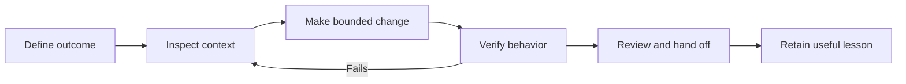

# The working loop

**Use when:** you want to turn a request into a reviewable result. Scale the effort to the uncertainty and consequences; a spelling correction and a shared workflow do not need the same ceremony.

## Define the outcome

Describe a person, a job, and a visible result. “Improve the dashboard” leaves the agent to invent your priorities. “A coordinator can find their overdue requests and export the filtered list” identifies a job you can test.

Agree what must hold before calling the task done. Include the primary action, a meaningful failure or empty case, and any existing behavior that must survive. Decide what is explicitly outside scope. If you cannot explain why the change matters, spend the next few minutes on the problem rather than on code.

The [task brief](../templates/task-brief.md) is a starting aid. OpenAI's current [best-practice guidance](https://learn.chatgpt.com/guides/best-practices) similarly distinguishes goal, context, constraints, and completion conditions. That is useful structure, not a required incantation.

## Inspect before choosing the implementation

Have the agent find the existing pattern, applicable instructions, run commands, tests, and affected contracts. Ask it to distinguish observations from assumptions. The point is to avoid building a second mechanism when the project already has one.

For uncertain work, request a short plan: approach, affected areas, open decisions, verification, and recovery. Resolve decisions whose answers materially change the implementation. Let ordinary reversible implementation choices proceed within the agreed scope.

## Make a bounded change

Choose a slice that can work end to end. For the export example, first export a small known filtered set using the existing data path. A polished button connected to an untested stub is a weaker stopping point.

Ask the agent to continue through implementation and verification, fixing failures caused by its change. State external boundaries concretely: whether it may install packages, connect services, spend money, send messages, deploy, or change production data. Natural-language boundaries should accompany actual tool and account permissions.

Keep a recoverable starting state. For parallel work, assign distinct ownership and an integrator; see [advanced practice](advanced.md). Avoid combining a behavior change with unrelated refactoring unless it is necessary to make the change safely.

## Verify the outcome

Run the project's required static checks, then exercise real behavior. Check the produced thing: use the UI, read the exported file, inspect the stored record, or open the generated document. Confirm that the environment and version are the ones you intend to review.

Ask for evidence tied to acceptance criteria, including skipped checks. A command that exited successfully proves only what that command checked. A second agent's agreement adds little unless it independently inspects the result. See [verification](verification.md).

## Review and hand off

Review the diff and the result together. Can you connect the changed code to the observed behavior? Are new dependencies, permissions, configuration, or instruction edits justified? Are errors understandable? What will a future maintainer need to know?

The handoff should let someone resume without reconstructing the chat: outcome, artifact, exact commands, results, limits, and next step. Keep a decision record only when the choice has lasting consequences. Capture a reusable lesson only when it changes future work.

## Know when to change the loop

| Situation | Better next move |
| --- | --- |
| The same failure returns after several attempted fixes | Stop broad edits; reproduce and isolate the boundary |
| The plan keeps expanding | Deliver a smaller complete slice or resolve the missing decision |
| You cannot review the diff | Reduce scope or bring in someone who can assess the affected system |
| The agent lacks access to verify | Name the missing check and arrange an authorized run |
| The task repeats with stable inputs and outputs | Consider a script or skill after a successful manual run |

Progress is a useful, verified result and a project that remains understandable. Generated code volume, prompt count, and hours the agent guesses it saved are poor substitutes.
