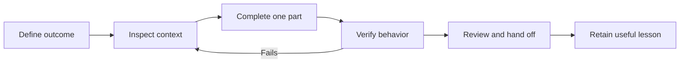

# The working loop

Use this process to take a request through implementation, checks, and review. Spend more time on uncertain work or changes with serious consequences. A spelling correction needs much less preparation than a shared workflow.

## Define the outcome

Describe who needs the change and what they should be able to do. With “improve the dashboard,” the agent has to guess your priorities. “A coordinator can find their overdue requests and export the filtered list” gives it a specific result you can check.

Agree how you'll decide the task is done. Cover the primary action, a meaningful failure or empty case, and existing behavior that needs to keep working. State what's outside scope too. If you can't explain why someone needs the change, work through that before asking for code.

If you're unsure what people need, identify the assumption you need to test. Watch the current workflow or try a small prototype within your authorized scope, then decide what feedback would change or stop the work. For example, “If coordinators need reminders rather than exports, drop the export.” This approach adapts the product judgment and feedback loop in Andrew Ng's [Shaping the build](https://www.linkedin.com/pulse/ai-engineering-skills-map-shaping-build-andrew-ng-td7uc/).

The [task brief](../templates/task-brief.md) can help you organize this. OpenAI's current [best-practice guidance](https://learn.chatgpt.com/guides/best-practices) also distinguishes the goal, context, constraints, and completion conditions. Use those prompts where they help; you don't need a form for every request.

## Inspect before choosing the implementation

Ask the agent to inspect how the project already handles similar work, which instructions apply, how to run it, and what tests and contracts the change affects. It should explain what it found and where it's making assumptions. Use the existing approach when it fits.

For uncertain work, ask for a short plan covering the approach, affected areas, open decisions, checks, and recovery. Settle decisions that would materially change the implementation. The agent can make ordinary, reversible implementation choices within the agreed scope.

## Start with one complete part

Choose a small part of the task that can work end to end. For the export example, start by exporting a known filtered set through the existing data path. You can then check the actual output before spending time polishing the button.

Ask the agent to finish the implementation and checks, including fixing failures caused by its change. Be explicit about whether it may install packages, connect services, spend money, send messages, deploy, or change production data. Set tool and account permissions to match those instructions.

Keep a starting state you can recover. If agents work in parallel, give each one distinct ownership and assign someone to integrate their work; see [advanced practice](advanced.md). Keep unrelated refactoring out of a behavior change unless it's necessary to make the change safely.

## Verify the outcome

Run the project's required static checks, then try the result. Use the UI, read the exported file, inspect the stored record, or open the generated document. Confirm you're checking the intended version in the right environment.

Ask the agent to show how the result meets the acceptance criteria and identify any checks it skipped. Check what each successful command actually tested. If a second agent reviews the work, have it inspect the result independently. See [verification](verification.md).

## Review and hand off

Review the diff alongside the result so you can connect the code changes to the behavior you observed. Look closely at new dependencies, permissions, configuration, and instruction changes. Each should have a reason. Check that errors make sense to the person who'll encounter them and that a future maintainer has what they need to continue.

In the handoff, include the outcome, artifact, exact commands and results, remaining limits, and next step. Someone should be able to resume from it without reading the whole chat. Record decisions with lasting consequences and lessons that would change how you handle similar work. You don't need a permanent record of every choice.

## When to change the approach

| Situation | Better next move |
| --- | --- |
| The same failure returns after several attempted fixes | Stop broad edits; reproduce the failure and find where it starts |
| The plan keeps expanding | Complete a smaller part of the task or resolve the missing decision |
| You cannot review the diff | Reduce scope or bring in someone who can assess the affected system |
| The agent lacks access to verify | Name the missing check and arrange an authorized run |
| The task repeats with stable inputs and outputs | Consider a script or skill after a successful manual run |

When assessing progress, look at what now works, how it was checked, and whether the project is still understandable. Code volume, prompt counts, and the agent's guesses about hours saved won't tell you that.
